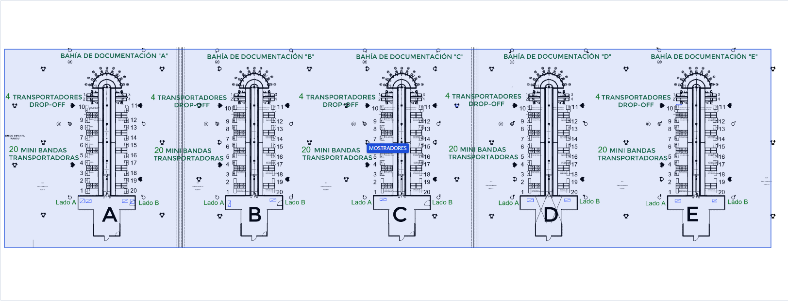
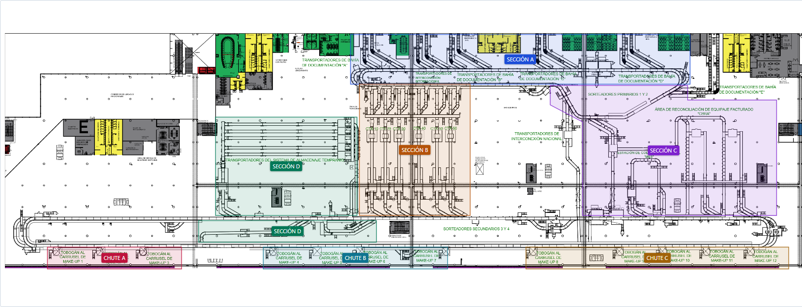
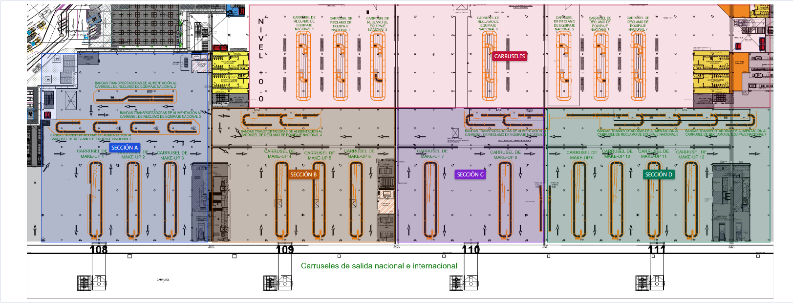

**Layout BHS — propuesta de calibración**

Revisión del 23 de octubre de 2026. Las regiones se prepararon sobre los PNG renderizados de los tres PDF y se contrastaron con las capturas de referencia. Sus límites siguen pendientes de confirmación del usuario.

Las coordenadas se expresan en porcentaje de la imagen **ya recortada**: X aumenta hacia la derecha e Y hacia abajo. Un rectángulo se describe como X, Y, ancho y alto. Un polígono enumera sus vértices en orden. No son coordenadas tomadas directamente de las capturas.

**Nivel 10.50**



| Sección | Región | X % | Y % | Ancho % | Alto % |
|---|---:|---:|---:|---:|---:|
| MOSTRADORES | 1 | 0.5 | 1 | 96.5 | 96 |

**Nivel 5.25**



| Sección | Región | X % | Y % | Ancho % | Alto % |
|---|---:|---:|---:|---:|---:|
| SECCIÓN A | 1 | 43.3 | 1 | 42 | 20.5 |
| SECCIÓN B | 1 | 44.4 | 21.5 | 13.7 | 54 |
| SECCIÓN C | 1: polígono | — | — | — | — |
| SECCIÓN D | 1 | 26.6 | 35 | 17.5 | 40.5 |
| SECCIÓN D | 2 | 24.5 | 77.6 | 22 | 8.9 |
| CHUTE A | 1 | 5.8 | 88.5 | 16.6 | 9 |
| CHUTE B | 1 | 32.5 | 88.5 | 22.8 | 9 |
| CHUTE C | 1 | 65 | 88.5 | 32.5 | 9 |

SECCIÓN C, región 1: (68 %, 22 %); (85 %, 22 %); (85 %, 28 %); (96 %, 28 %); (96 %, 75.5 %); (72 %, 75.5 %); (72 %, 37 %); (68 %, 30 %).

C y D dejan los sorteadores secundarios 3 y 4 sin sección asignada. La segunda región de D abarca ahora el tramo inferior señalado por el usuario en su captura: los recorridos LI (bypass) situados entre las líneas de los sorteadores, debajo del EBS. La ubicación se toma de esa referencia marcada; los códigos LI34/LI43 y la palabra bypass no se encontraron en el texto ni en las capas del PDF.

Actualización de D: en `dashboard_bhs_aifa.html`, línea 37243 antes y después, se sustituyó únicamente la región inferior `(39.5, 79.5, 6.3, 5.5)` por `(24.5, 77.6, 22, 8.9)` en formato X, Y, ancho, alto (%), y se añadió «Líneas LI (bypass)» a las áreas. El rectángulo grande `(26.6, 35, 17.5, 40.5)` se conserva. La región ampliada termina en Y = 86.5 %, antes de los chutes, que empiezan en Y = 88.5 %; comienza en Y = 77.6 %, por debajo de B y C, que terminan en Y = 75.5 %.

**Nivel 0.0**



| Sección | Región | X % | Y % | Ancho % | Alto % |
|---|---:|---:|---:|---:|---:|
| SECCIÓN A | 1 | 2.5 | 17.5 | 22 | 62.5 |
| SECCIÓN B | 1 | 25.1 | 35.5 | 24.2 | 44.5 |
| SECCIÓN C | 1 | 49.6 | 35.5 | 19.4 | 44.5 |
| SECCIÓN D | 1 | 69.5 | 35.5 | 29.5 | 44.5 |
| CARRUSELES | 1 | 30 | 1.5 | 69 | 34 |

La región C incluye los make-up 7 y 8 y la banda de alimentación al reclamo nacional 5, conforme a la asignación confirmada por el usuario. Su límite superior pasa de Y = 48.5 % a Y = 35.5 % y su alto de 31.5 % a 44.5 %; X, ancho y límite inferior se conservan. La captura refleja esta ampliación; los límites precisos siguen pendientes de validación.

**Verificación de las listas del nivel 0.0 contra el PDF**

| Sección | Equipos identificados en los rótulos del plano | Resultado |
|---|---|---|
| A | Make-up 1, 2 y 3; alimentación a reclamo nacional 1, 2 y 3 | Coincide con el borrador |
| B | Make-up 4, 5 y 6; alimentación a reclamo nacional 4 | Coincide con el borrador |
| C | Make-up 7 y 8; alimentación a reclamo nacional 5 | Equipos verificados en el plano; inclusión de la banda 5 confirmada por el usuario |
| D | Make-up 9, 10, 11 y 12; alimentación a reclamo nacional 6 y 7 | Coincide con el borrador |
| CARRUSELES | Reclamo de equipaje nacional 1 a 7 | Coincide con el borrador |

**Pendientes**

- Validación de todos los límites propuestos y de los porcentajes anteriores.
- Nivel 5.25: sorteadores secundarios 3 y 4, interconexión nacional y bahías de documentación A y E quedan sin sección asignada.
- Equivalencias de módulos y secciones: sin confirmar. Por instrucción confirmada del usuario, los rótulos impresos de módulos siguen ocultos en la vista mediante una capa SVG; los PNG originales se conservan. No se añaden nombres de módulo a las etiquetas ni al panel.
- Nivel -4 / SOTANO: sin imagen ni regiones; la vista muestra «Croquis pendiente».

**Imágenes y reproducción del recorte**

Ejecutar desde `Dashboard-BHS-main` con Windows PowerShell 5.1. El script utiliza componentes incluidos en Windows y no requiere instalar dependencias. La política indicada se aplica únicamente al proceso que ejecuta el script. `-Sobrescribir` permite reemplazar un PNG ya existente.

| Nivel | Archivo | Tamaño | Recorte sobre la página PDF: X, Y, ancho, alto % |
|---|---|---|---|
| 10.50 | `nivel-10-50.png` | 3000 × 780 | 0, 35, 100, 39 |
| 5.25 | `nivel-5-25.png` | 3000 × 900 | 0, 28, 100, 45 |
| 0.0 | `nivel-0-00.png` | 3000 × 1200 | 0, 20, 100, 60 |

```powershell
$planos = 'C:\Users\GSD_OPN2\Downloads'
powershell -NoProfile -ExecutionPolicy Bypass -File scripts/renderizar_layout.ps1 -Pdf (Join-Path $planos '02_Croquis de Localización BHS, Nivel +10.50, (1.1.1.5.1.)..pdf') -Salida 'assets/layout/nivel-10-50.png' -Y 35 -AltoRecorte 39 -Sobrescribir
powershell -NoProfile -ExecutionPolicy Bypass -File scripts/renderizar_layout.ps1 -Pdf (Join-Path $planos '04_Croquis de Localización BHS, Nivel +5.25, (1.1.1.5.2.). (1).pdf') -Salida 'assets/layout/nivel-5-25.png' -Y 28 -AltoRecorte 45 -Sobrescribir
powershell -NoProfile -ExecutionPolicy Bypass -File scripts/renderizar_layout.ps1 -Pdf (Join-Path $planos '03_Croquis de Localización BHS, Nivel +0.00, (1.1.1.5.3.)..PDF') -Salida 'assets/layout/nivel-0-00.png' -Y 20 -AltoRecorte 60 -Sobrescribir
```

**Cambios del paso Layout en dashboard_bhs_aifa.html**

Las líneas «antes» corresponden al archivo con el cambio 1 ya aplicado. Se añadieron 280 líneas para Layout. La actualización de la sección C modifica su región y su lista de áreas y elimina la línea que indicaba la banda 5 como pendiente de asignación.

| Bloque | Antes | Después |
|---|---|---|
| Estilos locales de Layout | Inserción antes de 320 | 320–338 |
| Botón entre Tendencias y Datos | Inserción antes de 395 | 414–417 |
| Vista Layout | Inserción antes de 835 | 858–885 |
| Datos de regiones e interacción | Inserción antes de 37167 | 37219–37445 |
| Selección de la vista estática | 37183–37184 | 37462–37464 |

Los nombres se recuperan del catálogo `areasScadaDemo`; no se altera su contenido.

**Comprobaciones**

- PNG de 3000 px de ancho, con proporciones conservadas y rutas relativas.
- Navegación, selector de los cuatro niveles, hover, salida, fijación y liberación de zonas.
- Zoom con botones y rueda, conservación del punto de zoom y desplazamiento por arrastre.
- Selección táctil y ajuste de imagen/SVG en una ventana de 390 px, sin desbordamiento horizontal de página.
- Preferencia por la región de menor área en solapamientos; regiones rectangulares y poligonales.
- Dos regiones de D y zonas expresamente sin asignación.
- Banda de alimentación al reclamo nacional 5 incluida en C, con información y selección táctil en la zona ampliada; rótulos de módulos ocultos.
- Vista independiente del cálculo de indicadores y tarjeta de SOTANO sin imagen.
- Diez gráficas anteriores con los mismos píxeles y tooltips; NAT = 3236 s e IOC = 317 s, con 12 eventos cada uno.
- Sin errores de JavaScript durante las comprobaciones.
